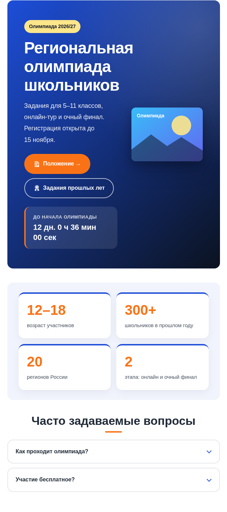
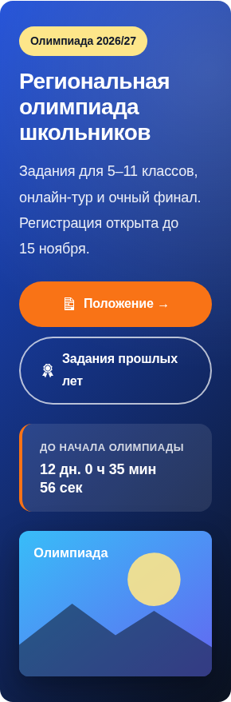
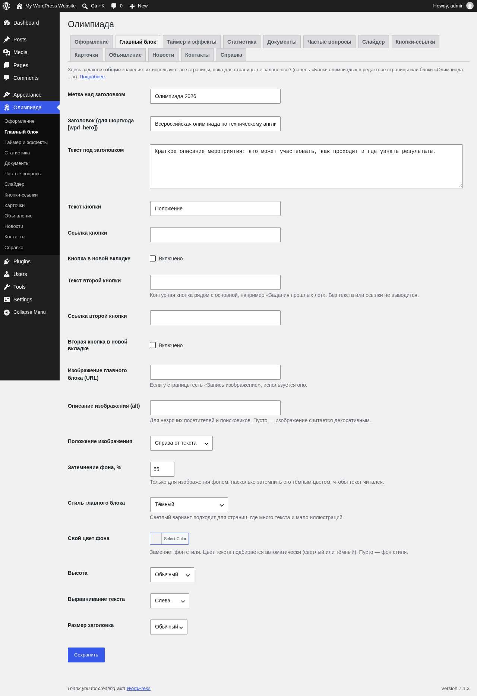
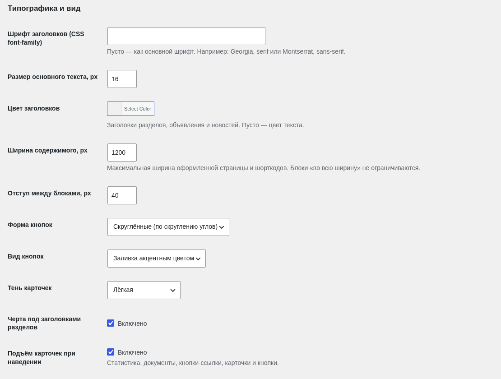
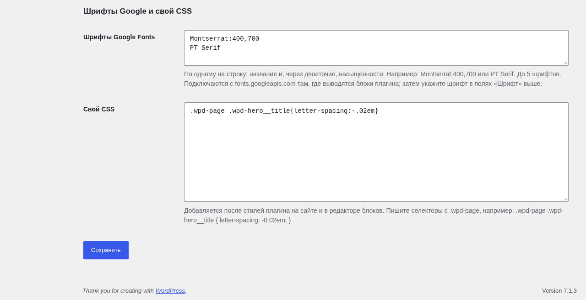
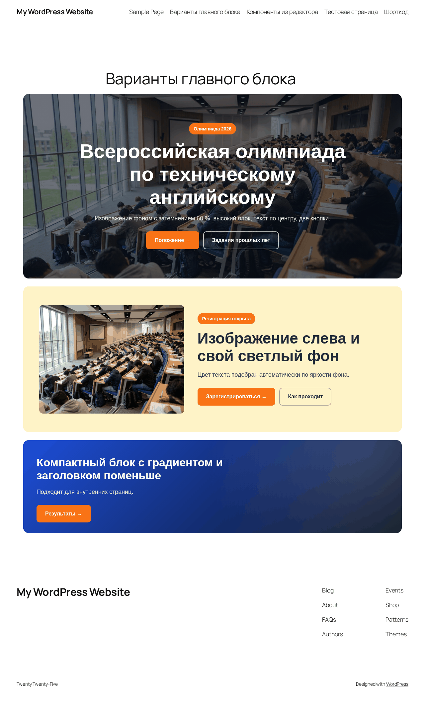
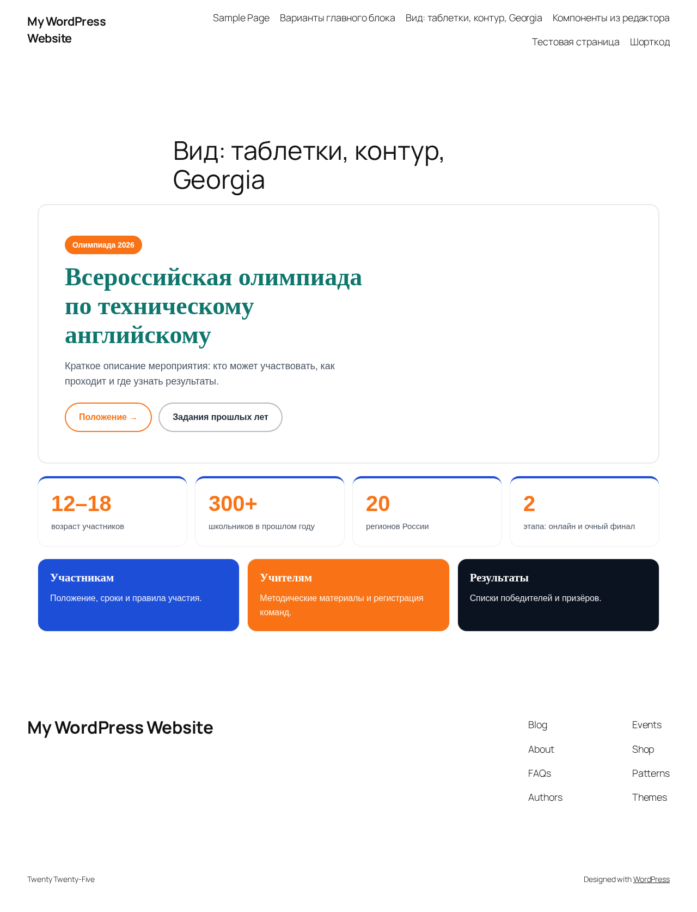
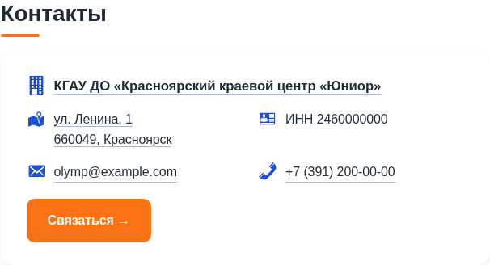
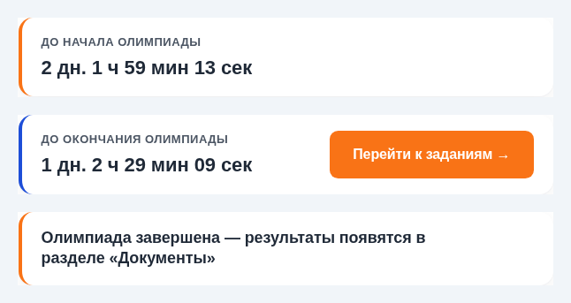

# WP Olympiad Design

Плагин для WordPress, который оформляет страницы в стиле сайта олимпиады (по образцу englishtecho.ru):

- **Главный блок** — тёмный фон, метка, крупный заголовок, текст, кнопка, изображение; с 1.8.0 — вторая кнопка,
  изображение слева или фоном с затемнением, свой цвет фона, высота, выравнивание и размер заголовка; с 1.9.0 — иконки
  на кнопках, таймер внутри блока, цвета метки, заголовка и текста, подгонка и рамка изображения, размеры в пикселях;
- **Статистика** — карточки с крупными цифрами («12–18 — возраст участников» и т. д.);
- **Документы** — список ссылок на положение, результаты и т. п. с иконками PDF/WEB;
- **FAQ** — аккордеон «Часто задаваемые вопросы» на нативных `<details>`, с поиском при 4 и более вопросах;
- **Обратный отсчёт** — таймер до начала под главным блоком (включается в настройках); с 1.6.0 после начала тот же блок
  считает время до окончания и показывает кнопку со ссылкой на внешний ресурс (например, платформу с заданиями).

Компоненты главной страницы (1.5.0, по образцу шаблона «Нодес» для Astra из проекта XTEC Agora):

- **Слайдер** — до 10 слайдов с изображением, заголовком, текстом и ссылкой, стрелки, точки, автопрокрутка;
- **Кнопки-ссылки** — плитки с иконками для быстрых переходов («Положение», «Регистрация», «Результаты»…);
- **Карточки** — цветные карточки-разделы с изображением и ссылкой;
- **Объявление** — изображение и/или текст с надзаголовком, цветом фона и ссылкой;
- **Новости** — последние записи рубрики каруселью (3 в ряд) или сеткой, со ссылкой «Все новости»;
- **Контакты** — адрес со ссылкой на карту, телефон, e-mail, реквизиты и кнопка «Связаться»;
- **Палитры** — готовые наборы цветов для всего оформления.

Регистрация участников (2.0.0):

- **Форма заявки** — ФИО, e-mail и любые свои поля из конструктора (текст, список, флажок, дата, число, телефон…),
  согласие на обработку персональных данных, сроки приёма (вручную, по датам или до начала таймера) и лимит мест;
- **Личный кабинет** — участник получает аккаунт с ролью «Участник олимпиады», видит номер и статус заявки и правит её;
- **«Участники» в админке** — список заявок с поиском, статусами «Новая / Подтверждена / Отклонена», счётчиком новых
  и выгрузкой в CSV для Excel; письма участнику и организатору; защита от спама без внешних сервисов.

Плагин не зависит от темы: компоненты работают с любой классической или блочной темой.

Всё настраивается без кода:

- **пункт меню «Олимпиада»** в админке — цвета, скругления, шрифт и *общее* содержимое блоков, по вкладкам;
- **панель «Блоки олимпиады»** в редакторе страницы — порядок блоков, их видимость и своё содержимое для конкретной страницы;
- **блоки редактора «Олимпиада: …»** — вставляются в любое место страницы, текст правится прямо на ней.

## Установка

1. Скопируйте папку `wp-olympiad-design` в `wp-content/plugins/`
   (или заархивируйте её и загрузите через **Плагины → Добавить новый → Загрузить**).
2. Активируйте плагин в разделе **Плагины**.
3. Заполните настройки в пункте меню **«Олимпиада»** (ссылка «Настройки» есть и в списке плагинов).

## Страница настроек «Олимпиада» (1.4.0)

Настройки вынесены из раздела «Настройки» в отдельный пункт главного меню админки **«Олимпиада»** (значок кубка).
Каждый раздел — отдельная вкладка, вкладки продублированы в подменю слева:

| Вкладка | Что настраивается |
|---|---|
| Оформление | палитра, цвета, скругления, шрифт, «Скрывать заголовок темы» и т. п.; с 1.8.0 — раздел «Типографика и вид»: шрифт и цвет заголовков, размер текста, ширина содержимого, отступ между блоками, форма и вид кнопок, тень карточек, черта под заголовками, подъём карточек; с 1.9.0 — насыщенность и размер заголовков, межстрочный интервал, цвет ссылок и текста кнопок, толщина рамок, выравнивание заголовков разделов, чередующийся фон, раздел «Шрифты Google и свой CSS» (29 полей) |
| Главный блок | метка, заголовок, текст, кнопка, изображение, вариант оформления; с 1.8.0 — «в новой вкладке», вторая кнопка, описание изображения, его положение, затемнение фона, свой цвет фона, высота, выравнивание, размер заголовка; с 1.9.0 — три подраздела («Текст и кнопки», «Изображение», «Вид главного блока»), иконки кнопок, таймер внутри блока, подгонка, рамка и цвет затемнения изображения, скрытие изображения на телефоне, цвета метки, заголовка и текста, минимальная высота, внутренний отступ, вертикальное выравнивание, ширина текста (32 поля) |
| Таймер и эффекты | обратный отсчёт (часовой пояс, начало, окончание, подписи, кнопка), поиск по FAQ, анимация чисел (12 полей) |
| Статистика | карточки `число|подпись` |
| Документы | заголовок блока и список ссылок |
| Частые вопросы | заголовок блока и вопросы с ответами |
| Слайдер (1.5.0) | слайды, высота, автопрокрутка, стрелки, точки, показ на телефонах |
| Кнопки-ссылки (1.5.0) | плитки: иконка, текст, ссылка, «в новой вкладке», мелкий текст |
| Карточки (1.5.0) | заголовок блока и карточки: название, текст, изображение, цвет, ссылка |
| Объявление (1.5.0) | вид, надзаголовок, заголовок, текст (визуальный редактор), изображение, цвет фона, ссылка |
| Новости (1.5.0) | заголовок, рубрика, количество, карусель или сетка, текст ссылки «Все новости» |
| Контакты (1.5.0) | заголовок, название организации и ссылка (1.7.0), адрес, город, телефон, e-mail, ссылка на карту, страница контактов, реквизиты |
| Справка | шорткоды, панель «Блоки олимпиады», блоки редактора, главная страница из компонентов — без формы |

- Кнопка «Сохранить» на вкладке сохраняет только поля этой вкладки, значения на остальных вкладках не меняются.
  После сохранения вы остаётесь на той же вкладке.
- Старый адрес `options-general.php?page=wpd-settings` (закладки, ссылки из 1.3.0) автоматически перенаправляет на новую страницу.
- Ссылки «Изменить в настройках» из панели «Блоки олимпиады» и из блоков редактора ведут сразу на нужную вкладку.
- Опция в базе осталась прежней (`wpd_settings`), поэтому при обновлении ничего переносить не нужно.

## Компоненты главной страницы (1.5.0)

У каждого компонента есть вкладка в меню «Олимпиада» (общее содержимое), блок редактора «Олимпиада: …», шорткод
и строка в панели «Блоки олимпиады». Компонент без данных ничего не выводит.

- **Слайды, кнопки и карточки** задаются списками: строка добавляется кнопкой «Добавить…», переставляется стрелками,
  удаляется корзиной. Изображения выбираются из медиатеки (кнопка «Медиатека…») или вставляются ссылкой.
  Пустые строки при сохранении отбрасываются. Ограничения: 10 слайдов, 12 кнопок, 8 карточек.
- **Слайдер.** Слайды листаются стрелками, точками, клавишами ← → и свайпом на телефоне. Автопрокрутка (каждые 6 секунд)
  останавливается при наведении и фокусе, на скрытой вкладке браузера и отключается совсем, если в системе включено
  «уменьшить движение». На телефонах слайдер можно скрыть, а заголовки и тексты слайдов показывать по отдельности.
- **Кнопки-ссылки.** Иконка выбирается из 46 значков Dashicons (превью рядом со списком). Кнопка без ссылки выводится как подпись.
- **Карточки.** Без цвета карточки чередуют основной, акцентный и тёмный цвета оформления; свой цвет можно задать каждой.
- **Объявление.** Три вида: «изображение и текст», «только текст», «только изображение». Если для вида не хватает данных
  (например, нет изображения), выбирается подходящий вид автоматически.
- **Новости.** Последние записи выбранной рубрики (или все записи). Анонс — цитата записи или первые 20 слов текста.
  Карусель показывает 3 записи на компьютере, а на планшете и телефоне — одну и край следующей; ссылка «Все новости» ведёт на страницу рубрики.
- **Контакты.** Телефон превращается в ссылку `tel:`, e-mail — в `mailto:`, адрес — в ссылку на карту (если задана).
  Кнопка «Связаться» ведёт на страницу контактов, а если её нет — на e-mail.
- **Палитры** (вкладка «Оформление»): Олимпиада, Море, Лес, Вишня, Фиалка, Графит. Выбор палитры подставляет её цвета
  в поля ниже. Правка любого цвета вручную переключает на «Свои цвета». По умолчанию выбраны «Свои цвета»,
  поэтому после обновления цвета сайта не меняются.

### Главная страница из компонентов

1. Создайте страницу «Главная» и в редакторе блоков выберите **Паттерны → Олимпиада → «Главная страница из компонентов»**
   (слайдер, кнопки-ссылки, объявление, карточки, новости, контакты). Блоки можно переставлять, удалять и дополнять обычными.
2. В **Настройки → Чтение** выберите «Статическую страницу» и укажите её как главную.

В классическом редакторе вставьте шорткоды `[wpd_slider]`, `[wpd_buttons]`, `[wpd_notice]`, `[wpd_cards]`, `[wpd_news]`,
`[wpd_contacts]` или включите оформление страницы и нужные компоненты в панели «Блоки олимпиады».

## Использование

Есть три способа, их можно сочетать:

| Способ | Где редактируется | Когда удобен |
|---|---|---|
| Оформленная страница + панель «Блоки олимпиады» | мета-бокс под редактором (блочный и классический редактор) | страница целиком в стиле олимпиады, свои тексты и порядок блоков |
| Блоки «Олимпиада: …» | прямо на холсте редактора блоков | блоки вперемешку с обычным содержимым |
| Шорткоды `[wpd_*]` | — (содержимое из общих настроек) | виджеты, шаблоны, классический редактор без панели |

### Оформить страницу целиком

Откройте редактор страницы и в правой колонке включите галочку **«Оформление в стиле олимпиады»**.
Заголовок страницы станет главным блоком, текст записи выведется в белой карточке, ниже появятся статистика, документы и FAQ из настроек.
Если у записи есть «Запись изображение», оно попадёт в главный блок; иначе берётся изображение из настроек.
Если в настройках включено «Скрывать заголовок темы», стандартный заголовок темы на такой странице скрывается.

### Панель «Блоки олимпиады» (1.3.0)

Под редактором страницы появилась панель **«Блоки олимпиады»**. В блочном редакторе она находится в области
**Meta Boxes** внизу экрана (разверните её стрелкой), в классическом — сразу под полем текста.
Изменения сохраняются вместе со страницей.

- **Блоки и порядок.** Двенадцать блоков: слайдер, главный блок, кнопки-ссылки, обратный отсчёт, объявление, текст страницы,
  карточки, статистика, новости, документы, частые вопросы, контакты.
  Порядок меняется перетаскиванием (за значок ☰) или стрелками. Снятая галочка — блок не выводится на этой странице.
  Компоненты 1.5.0 (слайдер, кнопки, объявление, карточки, новости, контакты) по умолчанию выключены, поэтому
  уже оформленные страницы после обновления не меняются. Их содержимое берётся из общих настроек.
- **Главный блок.** Свои заголовок, метка, текст, кнопка (текст и ссылка), изображение из медиатеки и стиль.
  Пустое поле — значение по умолчанию: заголовок записи, цитата записи, изображение записи, остальное из общих настроек
  (в подсказке поля видно, что именно подставится).
- **Статистика, документы, частые вопросы.** Переключатель «Из общих настроек / Свои для этой страницы».
  В режиме «Свои» строки добавляются кнопкой, удаляются корзиной, переставляются стрелками или перетаскиванием.
  Кнопка «Скопировать из общих настроек» заполняет список текущими общими значениями — удобно, чтобы поправить одну строку.
  Для документа файл можно выбрать из медиатеки (кнопка «Файл…»). У документов и FAQ можно задать свой заголовок блока.
- Обратный отсчёт на оформленной странице использует дату из общих настроек и выводится, только если он там включён.

Если данные панели совпадают со значениями по умолчанию, мета-поле не хранится.

### Блоки редактора «Олимпиада: …» (1.3.0)

В редакторе блоков есть категория **«Олимпиада»** с тринадцатью блоками:

| Блок | Что правится на холсте | Что правится в боковой панели |
|---|---|---|
| Олимпиада: главный блок | метка, заголовок, текст, тексты двух кнопок (1.8.0) | стиль, свой фон, высота, выравнивание, размер заголовка; ссылки кнопок и «в новой вкладке»; изображение (медиатека или URL), его положение, затемнение, описание (1.8.0); иконки кнопок, таймер, подгонка и рамка изображения, показ на телефоне, цвет затемнения, панели «Размеры» и «Цвета текста» (1.9.0) |
| Олимпиада: обратный отсчёт | подписи до начала и до окончания, текст кнопки | дата начала и окончания, текст после окончания, ссылка кнопки, «в новой вкладке» |
| Олимпиада: статистика | числа и подписи, добавление/перестановка/удаление карточек | — |
| Олимпиада: документы | заголовок, названия, ссылки, выбор файла из медиатеки | — |
| Олимпиада: частые вопросы | заголовок, вопросы, ответы (жирный, курсив, ссылки) | — |
| Олимпиада: слайдер (1.5.0) | заголовки и тексты слайдов, изображения, добавление/перестановка/удаление | высота, автопрокрутка, стрелки, точки, телефоны |
| Олимпиада: кнопки-ссылки (1.5.0) | тексты, иконки, ссылки, мелкий текст | — |
| Олимпиада: карточки (1.5.0) | заголовок, названия, тексты, изображения, цвета, ссылки | — |
| Олимпиада: объявление (1.5.0) | надзаголовок, заголовок, текст | вид, изображение, цвет фона, ссылка |
| Олимпиада: новости (1.5.0) | — (предпросмотр как на сайте) | заголовок, рубрика, количество, карусель/сетка, ссылка «Все новости» |
| Олимпиада: контакты (1.5.0) | заголовок, название организации, адрес, телефон, e-mail, реквизиты | ссылка организации, ссылка на карту, страница контактов |
| Олимпиада: регистрация (2.0.0) | — (предпросмотр формы) | заголовок, вступление, текст кнопки; ссылки на настройки регистрации и список заявок |
| Олимпиада: личный кабинет (2.0.0) | — (предпросмотр) | заголовок |

- Новый блок заполнен текущими общими настройками. Поля, которые вы не меняли, не сохраняются в странице
  и продолжают следовать за общими настройками. Изменённые поля хранятся в блоке.
  Кнопка **«Вернуть значения из настроек»** (боковая панель → «Значения по умолчанию») сбрасывает блок.
- Блоки поддерживают выравнивание «Широкое» и «Во всю ширину» и дополнительный CSS-класс.
- Блоки динамические: разметку на сайте строит PHP, поэтому она совпадает с шорткодами и оформленными страницами,
  а изменения стилей плагина применяются ко всем уже вставленным блокам.
- Готовые шаблоны: **Паттерны → Олимпиада → «Страница олимпиады»** (главный блок, таймер, абзац, статистика, документы, FAQ)
  и **«Главная страница из компонентов»** (1.5.0).
- Блоки и оформление страницы целиком лучше не включать одновременно: главный блок и списки повторятся.
  Панель предупреждает об этом.

### Шорткоды

| Шорткод | Что выводит |
|---|---|
| `[wpd_page]` | все блоки сразу: главный блок, статистику, документы, FAQ |
| `[wpd_hero]` | только главный блок (из настроек) |
| `[wpd_stats]` | только статистику |
| `[wpd_docs]` | только документы |
| `[wpd_faq]` | только FAQ |
| `[wpd_countdown]` | только обратный отсчёт (если включён в настройках и задана дата начала), с кнопкой на время этапа |
| `[wpd_slider]` | слайдер (1.5.0) |
| `[wpd_buttons]` | кнопки-ссылки (1.5.0) |
| `[wpd_cards]` | карточки (1.5.0) |
| `[wpd_notice]` | объявление (1.5.0) |
| `[wpd_news]` | последние новости (1.5.0) |
| `[wpd_contacts]` | контакты: название организации со ссылкой, адрес, телефон, e-mail (1.5.0, название — 1.7.0) |
| `[wpd_registration]` | форма регистрации участника (2.0.0) |
| `[wpd_cabinet]` | личный кабинет участника (2.0.0) |

Блоки со статистикой, документами и FAQ не выводятся, если их поля пустые.
Обратный отсчёт выводится под главным блоком на оформленной странице и в `[wpd_page]`, если он включён.

## Формат полей

- **Статистика:** одна карточка на строку, `число|подпись`.
  ```
  12–18|возраст участников
  300+|школьников в прошлом году
  ```
- **Документы:** одна ссылка на строку, `название|ссылка`.
  ```
  Положение об олимпиаде|https://example.com/polozhenie.pdf
  ```
- **FAQ:** блоки разделяются пустой строкой. В блоке первая строка — вопрос, остальные — ответ. Разрешены теги `a`, `strong`, `em`, `br`.
  ```
  Как проходит олимпиада?
  В два этапа: онлайн-отбор и очный финал.

  Участие бесплатное?
  Да.
  ```

## Стили и совместимость

- Все стили начинаются с класса `.wpd-page`, поэтому не конфликтуют с темой. Шрифт и цвета задаются переменными `--wpd-*`.
- JavaScript нужен только для интерактива (таймер, поиск по FAQ, анимация чисел, печать FAQ, стрелки и автопрокрутка слайдера
  и новостей). Без него все блоки показывают статический текст и остаются читаемыми, слайды и новости листаются прокруткой.
- Иконки Dashicons подключаются на сайте только на страницах с кнопками-ссылками или контактами.
- Скрипт `wpd.js` подключается в футере, и только там, где подключён CSS.
- Шрифт (и с 1.8.0 отдельный шрифт заголовков) задаётся в настройках как CSS `font-family`. С 1.9.0 шрифты Google Fonts
  можно подключить прямо в настройках (раздел «Шрифты Google и свой CSS»), без правки темы.
- Плагин рассчитан на классические темы и блочные темы. Для блочных тем скрытие заголовка работает через класс `.wp-block-post-title`.

## Регистрация участников (2.0.0)

### Как подключить

1. Создайте страницу с формой: шорткод `[wpd_registration]` или блок **«Олимпиада: регистрация»**.
2. Создайте страницу личного кабинета: шорткод `[wpd_cabinet]` или блок **«Олимпиада: личный кабинет»**.
3. В меню **Олимпиада → Регистрация** на вкладке «Приём заявок» выберите обе страницы.

Заявки появляются в меню **Олимпиада → Участники**. Рядом с пунктом показывается число новых заявок.

### Настройки (Олимпиада → Регистрация)

| Вкладка | Что настраивается |
|---|---|
| Приём заявок | приём открыт или закрыт; сроки: всегда, по датам (часовой пояс таймера, по умолчанию МСК) или до начала таймера; лимит мест и показ «Осталось мест»; аккаунты участников, вход сразу после заявки, правка заявки в кабинете; страницы формы и кабинета; префикс номера (`OL-0001`); тексты формы (заголовок, вступление, кнопка, сообщение об успехе, «ещё не начался», «закрыт», «места заняты»); текст согласия и ссылка на политику; лимит заявок с одного адреса в час |
| Поля формы | конструктор: ФИО и e-mail есть всегда, остальные поля добавляются, удаляются и переставляются. Типы: строка, многострочный текст, телефон, число, дата, список, выбор одного варианта, флажок. У поля — подпись, подсказка, варианты (по одному в строке), «обязательное», «показывать в списке заявок». По умолчанию: телефон, класс (5–11), школа, регион/город |
| Письма | письмо участнику о приёме заявки, о смене статуса, уведомление организатору (адрес по умолчанию — e-mail сайта). Темы и тексты с подстановками `{name}`, `{email}`, `{number}`, `{status}`, `{fields}`, `{cabinet}`, `{site}` |

### Как это работает

- **Заявка.** Значения проверяются на сервере (e-mail, телефон, число, дата, варианты списка, обязательные поля);
  при ошибке форма показывается снова с введёнными значениями и сообщением у каждого поля (`aria-invalid`, `aria-describedby`).
  Один e-mail — одна заявка. Номер выдаётся по порядку атомарно, поэтому две одновременные заявки не получат один номер.
- **Аккаунт.** Если аккаунты включены, создаётся пользователь с ролью «Участник олимпиады» (только чтение),
  WordPress присылает ссылку для установки пароля, а участник сразу входит на сайт и попадает в кабинет.
  Участник не видит консоль и верхнюю панель: `/wp-admin` и вход через `wp-login.php` ведут в кабинет.
  Без аккаунтов заявка просто сохраняется, сообщение об успехе показывается на странице формы.
- **Кабинет.** Номер, статус, дата подачи и данные заявки. Пока заявка «Новая» и приём открыт, её можно изменить
  (e-mail менять нельзя — он привязан к аккаунту). Гостю кабинет показывает форму входа (e-mail или логин) и ссылку «Подать заявку».
- **Лимит мест.** Считаются новые и подтверждённые заявки; отклонённая заявка освобождает место.
- **Защита от спама** без капчи и внешних сервисов: скрытое поле-ловушка, подписанная метка времени
  (форма, отправленная быстрее чем за 3 секунды или старше 7 дней, не принимается; порог меняет фильтр `wpd_reg_min_seconds`),
  лимит заявок с одного адреса в час (адрес хранится только в виде хеша).
- **Админка «Участники».** Столбцы: номер, ФИО, e-mail, поля с отметкой «в списке», статус, аккаунт, дата.
  Отбор по статусу, поиск (по ФИО, e-mail, номеру и полям), сортировка по номеру, групповая смена статуса,
  быстрые «Подтвердить / Отклонить» в строке. В карточке заявки — все поля и статус с флажком «Уведомить участника».
  Создавать заявки вручную нельзя; работать с ними может только администратор (`manage_options`).
- **CSV.** Кнопка «Экспорт в CSV» над списком выгружает все заявки или заявки выбранного статуса: UTF-8 с BOM
  и разделителем `;` — файл сразу открывается в Excel. Значения, начинающиеся с `=`, `+`, `-`, `@`, экранируются апострофом,
  чтобы Excel не выполнил их как формулу.
- **Персональные данные.** Заявки подключены к инструментам WordPress «Экспорт / Удаление персональных данных»
  (Инструменты). При удалении плагина заявки и настройки регистрации удаляются, аккаунты участников остаются
  с ролью «Подписчик».

### Для разработчиков

- Тип записи `wpd_application` (не публичный), мета-поля `_wpd_number`, `_wpd_status`, `_wpd_email`, `_wpd_fields`, `_wpd_user`;
  опции `wpd_registration` (настройки) и `wpd_reg_counter` (счётчик номеров); роль `wpd_participant`.
- События: `wpd_reg_submitted ($post_id, $values, $user_id)`, `wpd_reg_updated ($post_id, $values)`,
  `wpd_reg_status_changed ($post_id, $status, $old)`; фильтр `wpd_reg_min_seconds`.
- Шорткоды принимают `title`, `intro`, `button` (форма) и `title` (кабинет); пустое значение — из настроек.

## Ещё параметры главного блока и оформления (1.9.0)

### Главный блок

Вкладка **«Главный блок»** разделена на три подраздела: «Текст и кнопки», «Изображение», «Вид главного блока».
Новые параметры есть и на вкладке, и в блоке «Олимпиада: главный блок»:

| Параметр | Значения | По умолчанию |
|---|---|---|
| Иконка кнопки, иконка второй кнопки | без иконки или одна из иконок Dashicons (как у кнопок-ссылок) | без иконки |
| Таймер внутри главного блока | флажок; даты и подписи — с вкладки «Таймер и эффекты» | выкл. |
| Подгонка изображения | заполнить рамку, вписать целиком (для изображения справа или слева) | заполнить |
| Рамка изображения | скруглённые углы, скруглённые углы и тень, прямые углы, круг | скруглённые углы |
| Показывать изображение на телефоне | флажок (до 820 px) | вкл. |
| Цвет затемнения | любой цвет, для изображения фоном | свой фон или тёмный цвет |
| Цвет метки | фон метки; цвет её текста подбирается по яркости | акцентный |
| Цвет заголовка, цвет текста под заголовком | любой цвет | по стилю и фону |
| Минимальная высота | 0–900 px, на телефоне не больше 70 % высоты экрана | 0 (по содержимому) |
| Внутренний отступ | 0–120 px, на телефоне не больше 32 px | 0 (по высоте блока) |
| Вертикальное выравнивание | по верху, по центру, по низу | по центру |
| Максимальная ширина текста | 0–1200 px | 0 (автоматически) |

- Когда таймер включён внутри главного блока, отдельный таймер под ним на оформленной странице и в `[wpd_page]`
  не выводится, так что отсчёт на странице один. Если дата на вкладке «Таймер и эффекты» не задана, таймера нет,
  а в редакторе показывается подсказка.
- В блоке редактора добавлены панели «Размеры» и «Цвета текста». Иконки и флажок «Таймер под кнопками» находятся
  в панели «Кнопки», подгонка, рамка, показ на телефоне и цвет затемнения — в панели «Изображение».
- Разметка: иконка — `<span class="wpd-btn__icon dashicons dashicons-…" aria-hidden="true">` в начале кнопки, таймер —
  `div.wpd-hero__countdown`. Классы секции: `wpd-hero--fit-contain`, `--imgstyle-{shadow|square|circle}`,
  `--img-hide-mobile`, `--valign-{top|bottom}`, `--c-badge|c-title|c-text`, `--minh`, `--pad`, `--text-w`.
  Переменные: `--wpd-hero-overlay-color`, `--wpd-hero-badge`, `--wpd-hero-badge-fg`, `--wpd-hero-title`, `--wpd-hero-text`,
  `--wpd-hero-minh`, `--wpd-hero-pad`, `--wpd-hero-text-w`. При значениях по умолчанию разметка такая же, как в 1.8.0.







### Оформление

В разделе «Типографика и вид» вкладки **«Оформление»** появились новые параметры:

| Параметр | Значения | По умолчанию |
|---|---|---|
| Насыщенность заголовков | 400, 500, 600, 700, 800 | 800 |
| Размер заголовков разделов | меньше, обычный, крупнее | обычный |
| Межстрочный интервал | плотный (1,45), обычный (1,6), свободный (1,8) | обычный |
| Цвет ссылок в тексте | ссылки в тексте страницы, ответах FAQ, объявлении и контактах | как в теме |
| Цвет текста кнопок | для кнопок с заливкой | белый |
| Толщина рамок | 0–4 px (документы, вопросы FAQ, светлый главный блок) | 1 px |
| Заголовки разделов | слева, по центру | слева |
| Чередующийся фон разделов | каждый второй раздел оформленной страницы и `[wpd_page]` на светлой подложке | выкл. |

Новый раздел **«Шрифты Google и свой CSS»**:

- **Шрифты Google Fonts**: по одному на строку, название и через двоеточие насыщенности (`Montserrat:400,700`,
  `PT Serif`), до 5 шрифтов, повторы отбрасываются. Шрифты подключаются одной ссылкой
  `https://fonts.googleapis.com/css2?family=…&display=swap` только там, где выводятся стили плагина, в том числе
  в редакторе блоков. Затем укажите шрифт в полях «Шрифт» или «Шрифт заголовков», например `Montserrat, sans-serif`.
- **Свой CSS** добавляется после стилей плагина (`wp_add_inline_style`) на сайте и в редакторе. Символ `<` удаляется,
  максимум 20 000 символов. Пишите селекторы с `.wpd-page`.

Переменные: `--wpd-heading-weight`, `--wpd-h2-scale`, `--wpd-lh`, `--wpd-link`, `--wpd-btn-text`, `--wpd-border`
(только если значение отличается от значения по умолчанию). Классы `.wpd-page`: `wpd-page--titles-center`,
`--alt-sections`, `--link-color`. Если всё оставить по умолчанию, сайт выглядит так же, как в 1.8.0.





## Главный блок и «Типографика и вид» (1.8.0)

### Главный блок

На вкладке **«Главный блок»** и в блоке «Олимпиада: главный блок» появились новые параметры:

| Параметр | Значения | По умолчанию |
|---|---|---|
| Кнопка в новой вкладке | флажок | выкл. |
| Вторая кнопка: текст, ссылка, «в новой вкладке» | контурная кнопка рядом с основной; без текста или ссылки не выводится | — |
| Описание изображения (alt) | текст | пусто (декоративное) |
| Положение изображения | справа, слева, фоном на весь блок | справа |
| Затемнение фона | 0–90 % (только для изображения фоном) | 55 % |
| Свой цвет фона | любой цвет; цвет текста подбирается по яркости фона | фон стиля |
| Высота | компактный, обычный, высокий | обычный |
| Выравнивание текста | слева, по центру | слева |
| Размер заголовка | меньше, обычный, крупнее | обычный |

- В блоке редактора параметры разложены по панелям «Главный блок», «Кнопки» и «Изображение». Вторая кнопка
  правится прямо на холсте; свой фон выбирается из цветов палитры или любым цветом.
- Панель страницы «Блоки олимпиады» не изменилась: новые параметры для оформленной страницы берутся из общих настроек.
- Разметка: кнопки лежат в `div.wpd-hero__actions`, вторая кнопка — `a.wpd-btn.wpd-btn--ghost`; классы секции
  `wpd-hero--img-{right|left|background}`, `--height-{compact|tall}`, `--align-center`, `--title-{small|large}`,
  `--custom-bg` с `--fg-light`/`--fg-dark`. Изображение фоном и затемнение передаются переменными `--wpd-hero-img`
  и `--wpd-hero-overlay`. При значениях по умолчанию разметка секции такая же, как в 1.7.0.



### Типографика и вид

Новый раздел на вкладке **«Оформление»** действует на все блоки плагина — на оформленных страницах, в шорткодах и блоках:

| Параметр | Значения | По умолчанию |
|---|---|---|
| Шрифт заголовков | CSS `font-family`, пусто — основной шрифт | пусто |
| Размер основного текста | 14–20 px | 16 px |
| Цвет заголовков | любой цвет, пусто — цвет текста | пусто |
| Ширина содержимого | 720–1600 px | 1200 px |
| Отступ между блоками | 16–96 px | 40 px |
| Форма кнопок | скруглённые, прямоугольные, таблетка | скруглённые |
| Вид кнопок | заливка, контур | заливка |
| Тень карточек | нет (тонкая рамка), лёгкая, заметная | лёгкая |
| Черта под заголовками разделов | флажок | вкл. |
| Подъём карточек при наведении | флажок | вкл. |

- Значения передаются переменными `--wpd-font-heading`, `--wpd-size`, `--wpd-heading`, `--wpd-width`, `--wpd-gap`
  (только если отличаются от значений по умолчанию) и классами корневого `.wpd-page`: `wpd-page--btn-square|pill`,
  `--btn-outline`, `--shadow-none|strong`, `--no-underline`, `--no-hover`. Холст редактора блоков получает те же классы.
- При значениях по умолчанию сайт выглядит так же, как в 1.7.0.



## Название организации в контактах (1.7.0)

- На вкладке **«Контакты»** два новых поля: **«Название организации»** и **«Ссылка организации»**.
- Название выводится первой строкой блока контактов, во всю ширину, со значком здания. Если ссылка задана, название
  становится ссылкой: на другой сайт — в новой вкладке (`target="_blank" rel="noopener noreferrer"`), на свой сайт
  (тот же домен, с `www.` или без, относительная ссылка) — в той же вкладке. Ссылки `javascript:` отбрасываются.
- Блок контактов выводится, даже если заполнено только название.
- В блоке «Олимпиада: контакты» название правится прямо на холсте, ссылка — в боковой панели («Ссылки»). Пустое поле
  блока берёт значение из настроек.
- Разметка: `<li class="wpd-contacts__org">`; функция `WPD_Renderer::is_external()` определяет, ведёт ли ссылка на другой сайт.



## Таймер окончания и кнопка (1.6.0)

Настройки — на вкладке **«Таймер и эффекты»**. Один блок работает по этапам, друг за другом:

| Этап | Когда | Подпись | Значение | Кнопка |
|---|---|---|---|---|
| до начала | раньше даты начала | «Подпись до начала» | время до начала | скрыта |
| идёт этап | между началом и окончанием | «Подпись до окончания» | время до окончания | видна |
| завершено | после окончания | — | «Текст после окончания» | скрыта |

- **Дата и время окончания** необязательна. Если её нет, всё работает как раньше: один таймер до начала,
  потом текст после окончания, а кнопка видна с момента начала.
- Окончание не позже начала игнорируется; при сохранении вкладки появится предупреждение (значения сохраняются).
- **Кнопка** выводится, если заданы и текст, и ссылка (`http(s)://`; `javascript:` отбрасывается). По умолчанию открывается
  в новой вкладке (`target="_blank" rel="noopener noreferrer"`), флажок «Кнопка в новой вкладке» это отключает.
- Этапы переключаются на лету, без перезагрузки страницы, ровно в момент начала и окончания. Без JavaScript сервер сразу
  выводит нужный этап: дату начала, дату окончания или текст после окончания, с кнопкой во время этапа.
- В блоке «Олимпиада: обратный отсчёт» всё это задаётся отдельно для страницы: пустое поле берёт значение из настроек.
- Разметка: у `.wpd-countdown` есть атрибут `data-phase` (`before`, `active`, `done`) для своих стилей; кнопка —
  `.wpd-countdown__link`. Во время этапа левая полоса блока — основного цвета.



### Часовой пояс таймера (1.6.1)

- Поле **«Часовой пояс таймера»** на той же вкладке, по умолчанию **Москва (МСК, UTC+3)**. Даты начала и окончания —
  и в настройках, и в блоке «Олимпиада: обратный отсчёт» — указываются по этому поясу, независимо от часового пояса сайта.
- Варианты: Калининград (МСК−1) … Петропавловск-Камчатский (МСК+9) и «Как в настройках сайта».
- Остаток времени у посетителя из любого города правильный: в разметку дата попадает со смещением
  (`data-target="2031-05-10T10:00:00+03:00"`), а отсчёт идёт по часам посетителя относительно этого момента.
- Дата, которую видно без JavaScript, и даты на холсте редактора подписаны поясом: «10.05.2031 10:00 МСК». Для пояса сайта
  вне списка — «UTC+5:30» и т. п.
- В PHP: `WPD_Settings::countdown_timezone()` (объект `DateTimeZone`) и `WPD_Settings::countdown_tz_label()` («МСК», «МСК+4»…).

## Возможности 1.2.0

Настройки находятся на вкладке **«Таймер и эффекты»** (до 1.4.0 — раздел «Возможности»).

- **Обратный отсчёт.** Включите флажок «Обратный отсчёт», укажите «Дата и время начала» (по часовому поясу таймера, по умолчанию московскому), подпись и текст после окончания. Без JavaScript выводится сама дата.
- **Вариант главного блока.** `dark` (тёмный, по умолчанию), `gradient` (градиент из основного и тёмного цветов), `light` (светлый, с рамкой).
- **Поиск по FAQ.** Флажок «Поиск по вопросам FAQ». Строка поиска появляется, если вопросов четыре и больше.
- **Анимация чисел.** Флажок «Анимация чисел статистики». Числа вида `300`, `300+` или `50%` считаются от нуля при появлении блока на экране. Диапазоны вроде `12–18` не анимируются. При настройке «уменьшить движение» анимации нет.
- **Печать.** Версия для печати скрывает кнопки, таймер и поиск, убирает фоны, а все вопросы FAQ раскрываются.
- **Стилистика.** Подчёркивание заголовков разделов, подъём карточек при наведении, адаптация под узкие экраны.

Шорткод для таймера: `[wpd_countdown]`.

## Что нового в 1.1.0

- CSS подключается только на страницах, где есть оформленная запись или шорткод плагина. На остальных страницах сайта стиль не загружается.
- Настройки читаются один раз за запрос. Кеш сбрасывается автоматически при сохранении, добавлении или удалении опции.
- Если шорткод стоит в виджете или шаблоне, CSS всё равно подключится, но позже (в футере). Чтобы подключать CSS на всех страницах, используйте фильтр:
  ```php
  add_filter('wpd_always_enqueue_assets', '__return_true');
  ```

## Для разработчиков

- Фильтр `wpd_post_types` — типы записей, для которых доступны оформление и панель (по умолчанию `page`, `post`):
  ```php
  add_filter('wpd_post_types', function ($types) { $types[] = 'event'; return $types; });
  ```
- Мета-поле `_wpd_page` — данные панели (порядок, скрытые блоки, главный блок, списки). Удаляется при деинсталляции.
- Блоки зарегистрированы как `wpd/hero`, `wpd/countdown`, `wpd/stats`, `wpd/docs`, `wpd/faq`, `wpd/slider`, `wpd/buttons`,
  `wpd/cards`, `wpd/notice`, `wpd/news`, `wpd/contacts`, с 2.0.0 — `wpd/registration` и `wpd/cabinet`; сборка не нужна (скрипт на глобальных пакетах `wp.*`).
- Фильтр `wpd_news_query` — аргументы `get_posts()` для блока новостей (1.5.0):
  ```php
  add_filter('wpd_news_query', function ($q) { $q['post_type'] = ['post', 'event']; return $q; });
  ```

## Структура

```
wp-olympiad-design/
├── wp-olympiad-design.php          # точка входа
├── includes/
│   ├── class-wpd-settings.php      # поля, дефолты, санитизация, парсеры, меню «Олимпиада» и вкладки
│   ├── class-wpd-renderer.php      # шорткоды, разметка блоков, оформленная страница, мета-бокс, стили и скрипт
│   ├── class-wpd-page-editor.php   # панель «Блоки олимпиады»: порядок, видимость, своё содержимое страницы
│   ├── class-wpd-blocks.php        # блоки редактора «Олимпиада: …», категория, паттерны
│   ├── class-wpd-registration.php  # регистрация (2.0.0): настройки, конструктор полей, форма, кабинет, письма, роль
│   └── class-wpd-participants.php  # «Участники» (2.0.0): список заявок, статусы, CSV, карточка заявки
├── assets/css/wpd.css              # стили блоков (сайт и редактор)
├── assets/css/wpd-admin.css        # стили панели «Блоки олимпиады»
├── assets/css/wpd-editor.css       # поля правки текста в блоках редактора
├── assets/css/wpd-settings.css     # страница настроек: списки, палитры, медиатека (1.5.0)
├── assets/js/wpd.js                # таймер, поиск по FAQ, анимация чисел, печать FAQ, слайдер и карусель новостей
├── assets/js/wpd-admin.js          # панель: перестановка, строки списков, медиатека
├── assets/js/wpd-settings.js       # страница настроек: списки, медиатека, выбор цвета, палитры, иконки (1.5.0)
├── assets/js/wpd-blocks.js         # блоки редактора
├── assets/js/wpd-reg-blocks.js     # блоки «регистрация» и «личный кабинет» (2.0.0)
└── uninstall.php                   # удаление настроек, мета-полей и заявок при деинсталляции
```

## Требования

WordPress 5.8+, PHP 7.4+.
